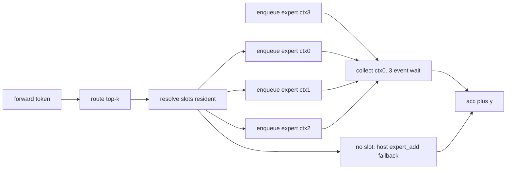

# Punto 3 — Decode asincrono degli expert (gpt-oss, `gptoss_ext/`)

Scope: **only** the async decode of the 4 top-k experts. GGUF stays untouched. No CUDA
compilation is run here (the CUDA branch is never compiled nor executed; only the emulated
device is testable). All edits are inside `gptoss_ext/diff.patch` (the source tree exists
only inside that patch).

## What already exists in the patch (verified)

| Piece | Where (`gptoss_ext/diff.patch`) | State |
| --- | --- | --- |
| `expert_run_async` / `expert_collect` declared, `kExpertCtxBatch = 4`, `ExpertDesc` | lines 309–320 (`include/gptoss/gpu.hpp`) | present |
| Emulated implementation (runs the whole expert immediately, then copies `y` out) | lines 1188–1218 (`src/gpu.cpp`) | present |
| Real CUDA implementation: 4 streams, one `ExpCtx` each, whole pipeline in ONE enqueue, CUDA graph for `N == 1`, `cudaEventRecord` | lines 1521–1589 + 1663–1687 (`src/gpu_cuda.cu`) | present |
| `reserve_scratch` (pre-allocates ctx 0..3 with `N == 1`) | lines 1651–1655 | present, **never called** |
| `Model::Impl::expert_add` = 2 synchronous `gpu::matmat_mx` (x up / y down) | lines 2187–2220 (`src/model.cpp`) | used by decode |
| `Model::forward` loop `for k < topk: expert_add(...)` | line 2347 (`src/model.cpp`) | the 4x synchronous calls |

Missing for punto 3: nobody calls `expert_run_async`/`expert_collect`; the biases
(`gate_up_proj_bias`, `down_proj_bias`) live only in the mmap and are added on the host,
so the descriptor's `gu_bias` / `dn_bias` (read inside `k_exp_act` / `k_exp_fin`) have no
device buffer to point at.

## Design

1. Give each `Slot` device copies of its two bias slices, uploaded with the expert
   (`+ (2I + H) * 2` bytes ~ 14 KiB on a 13.2 MiB slot: negligible).
2. Add one method `expert_add_batched(layer, work, h, idx, wt, acc)` that:
   resolves the slots, enqueues every resolved expert on its own context without waiting,
   then collects them one by one and accumulates `acc[i] += y_k[i]`
   (`k_exp_fin` already multiplies by `wt` and adds the bias, so no host math is repeated).
3. `Model::forward` calls it when the device is on and the pool is not empty; otherwise it
   keeps the existing per-expert path. Any expert without a slot, or any failed
   enqueue/collect, falls back to the current `expert_add` (host math), and a CUDA failure
   keeps the existing sticky behaviour (`gpu_on = false`).
4. Call `gpu::reserve_scratch(..., expert_batch_n = 1, H, I)` in `gpu_setup` before the
   pool is allocated, so no `cudaMallocHost` happens during decode once VRAM is full.

Numerics must stay identical: `k_exp_act` clamps `gate = min(gate, limit)`,
`up = clamp(up, -limit, limit)` then `(up+1) * gate * sigmoid(alpha*gate)`, which is the
same order as `ops.cpp::swiglu`; `bf2f(v) = (uint)v << 16` equals `bf16_to_f32`. The
emulated `gpu.cpp` reproduces the same arithmetic, so the existing golden test is the
equivalence check.

## Mermaid

## Steps

1. `struct Slot` (model.cpp block, lines 1784–1790): add `const uint16_t *gu_bias` and
   `*dn_bias` device pointers.
2. `upload_expert` (2132–2139): also `gpu::h2d` the two bias slices
   (`y.gu_bias + e * 2 * I`, `2 * I * 2` bytes; `y.dn_bias + e * H`, `H * 2` bytes).
3. `gpu_setup` (2071–2130): extend the slot layout with the two bias regions
   (`o5`, `slot_bytes`) and keep the printed MiB honest; call `reserve_scratch` for
   contexts 0..3 before allocating the pool.
4. Declare `bool expert_add_batched(Layer&, Work&, const float*, const int32_t*, const float*, float*)`
   in the `Model::Impl` declaration list (near line 1824).
5. Implement it next to `expert_add` (after line 2220): build `ExpertDesc` from the `Slot`
   (set `H`, `I`, `halves = o.glu_halves`, `limit = c.swiglu_limit`, `alpha = c.swiglu_alpha`),
   call `expert_run_async(k, desc, h, &wt[k], 1)` for `k < topk`, then `expert_collect(k, w.eb)`
   and accumulate; fall back per expert.
6. `Model::forward` (2347): use the batched call under `gpu_on && !pool.empty() && topk <= kExpertCtxBatch`,
   keep the old loop otherwise.
7. Keep `gmu` held around the whole batched block (same serialisation rule as the other device calls).
8. `docs/gptoss_porting.md` (GPU section, line 153–155) and `todo.md` (3785): state the async
   decode path exists, still marked "mai compilato ne' executed" for CUDA; no invented numbers.
9. Verification without CUDA: `sh build.sh` runs `test_gptoss_core` on the emulated device
   with `slots = -1, 5, 0` and prefill + decode; the golden comparison must stay green
   (this proves the async path equals the synchronous one). If the GGUF breakage blocks the
   CPU build, report it and stop; do not touch the GGUF branch.

## Result (done, 2026-10-12)

**Workflow correction:** the source tree is now materialized as real files under `gptoss_ext/`
(`src/`, `include/`, `docs/`, `tests/`, `tools/`, `build.sh`), extracted once from
`gptoss_ext/diff.patch` with `tools/extract_gptoss_patch.py`. The patch is kept only as the
historical import artifact; all future edits go to the real files. Build and tests run in place:
`python3 gptoss_ext/tools/tiny_gptoss.py gptoss_ext/tests/tiny && sh gptoss_ext/build.sh`.

Steps 1–5 and 7 were **already in the patch** (verified by grep before editing): slot bias
pointers (patch line 1787), bias `h2d` in `upload_expert` (2145–2146), slot layout `o5`/`o6`
+ `reserve_scratch` call in `gpu_setup` (2096, 2109), declaration of `expert_add_batched`
(1826), implementation with `gmu` held around the whole block (2234–2262).

Done in this session, all inside `gptoss_ext/diff.patch`:

- Step 6: `Model::forward` (patch line ~2392) now calls `expert_add_batched` under
  `gpu_on && !pool.empty() && topk <= gpu::kExpertCtxBatch`, else keeps the per-expert loop.
  model.cpp hunk header bumped `+1,771` → `+1,775`.
- Compile fixes found by the build (the patch is the only source, so errors only show after
  extraction): `Slot::gu_bias/dn_bias` were `const uint16_t*` → `gpu::h2d` rejected them
  (`const void*` → `void*`); made them plain `uint16_t*` and cast `(uint16_t*)` in `gpu_setup`.
  `kExpertCtxBatch` / `ExpertDesc` used unqualified in `model.cpp` → prefixed `gpu::` (4 sites).
- Step 8: docs paragraph (patch lines 156–158, porting-doc hunk `+1,82` → `+1,85`) and the
  `todo.md` DONE line (patch line 3836, hunk `+1,6` → `+1,7`).

Verification (scratch tree `/var/tmp/gptoss-ext-build`, never in the repo):

- `tools/extract_gptoss_patch.py` (new) extracts the 43 text files from the patch; the two
  safetensors + `profile.prof` are binary entries and are skipped, fixtures regenerated with
  `tools/tiny_gptoss.py tests/tiny` (deterministic: "ok: 79 tensori, 4 varianti").
- `sh build.sh` → **all ok**, including `device(emulated) slots=-1/5/0 decode max|diff| =
  3.32e-05, full prefill last-token = 6.92e-06` — byte-identical to the run without the
  batched path.
- The async path really runs: tiny config has `num_experts_per_tok: 2` (≤ 4); a temporary
  `fprintf` TRACE added **only in the extracted tree** printed `TRACE async-batched used`
  482 times across the suite, still `all ok`. No CUDA compiled; GGUF untouched.

Left alone: the pre-existing `-Wunused-variable 'H'` warning in `attn_heads` (model.cpp:266),
warning-only, not in scope.
